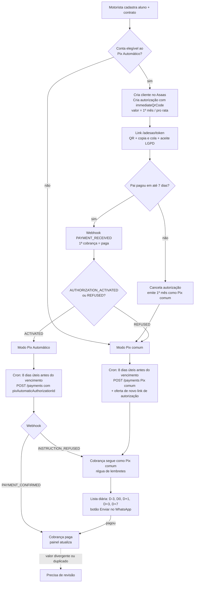

# Etapa 1: plano, dúvidas e suposições

> Status: **aguardando validação**. Nenhum código de aplicação foi escrito ainda.
> Nome provisório do produto: `[NOME_DO_PRODUTO]` (aparece como `Cobra Fácil` só nos exemplos, até você definir).

---

## 1. O que a documentação do Asaas confirma (lida em 06/11/2026)

Fontes: `docs.asaas.com/docs/pix-automatico`, `/pix-automatico-implementacao`, `/fluxos-de-webhook`, `/faq-2`, `/webhooks-2`, `/sandbox` e `reference/criar-uma-autorizacao-pix-automatico`.

| Tema | O que a doc diz | Impacto no produto |
|---|---|---|
| Modelo de adesão | A API usa a **Jornada 3**: um QR Code junta o pagamento da 1ª cobrança e a autorização das próximas. | Confirma o fluxo pedido no item 4.4. |
| Criar autorização | `POST /v3/pix/automatic/authorizations`. Obrigatórios: `frequency` (`MONTHLY`), `contractId` (máx. 35), `startDate`, `customerId`, `immediateQrCode { expirationSeconds, originalValue }`. Opcionais: `finishDate`, `value`, `minLimitValue`, `description` (máx. 35), `paymentCreationMode`, `retryPolicy`. | A resposta traz `id`, `payload` (copia e cola) e `encodedImage` (QR em base64). |
| Status da autorização | `CREATED`, `ACTIVE`, `CANCELLED`, `REFUSED`, `EXPIRED`. | Mapeio para pendente, ativa, cancelada, recusada e expirada. |
| Cobranças seguintes | Modo `MANUAL` (padrão): nós criamos cada cobrança em `POST /v3/payments` com `billingType: "PIX"` e `pixAutomaticAuthorizationId`. **A cobrança precisa ser criada entre 2 e 10 dias úteis antes do vencimento.** Sem `pixAutomaticAuthorizationId`, ela vira Pix comum. | A cobrança híbrida é simples: muda um campo. |
| Webhooks | Eventos `PIX_AUTOMATIC_RECURRING_AUTHORIZATION_{CREATED, ACTIVATED, REFUSED, CANCELLED, EXPIRED}`, `PIX_AUTOMATIC_RECURRING_PAYMENT_INSTRUCTION_{CREATED, SCHEDULED, REFUSED, CANCELLED}`, `PAYMENT_{CREATED, RECEIVED, CONFIRMED}` e `PIX_AUTOMATIC_RECURRING_ELIGIBILITY_UPDATED`. A entrega é "at least once" e a ordem não é garantida. A idempotência usa o `id` do evento. A autenticação usa o header `asaas-access-token`. Após 15 falhas seguidas, a fila pode ser pausada. | Gravo o evento, respondo 200 rápido e processo depois. |
| Pegadinha | Pode chegar `PAYMENT_RECEIVED` e depois `AUTHORIZATION_REFUSED`: **o 1º mês foi pago, mas a autorização falhou.** | A 1ª cobrança fica paga e o contrato passa para Pix comum. |
| Retentativas | Com `retryPolicy = ALLOW_THREE_IN_SEVEN_DAYS`, são até 3 tentativas em 7 dias após o vencimento. Só pode ser definido na criação. | Ver dúvida D4. |
| **Elegibilidade** | A conta precisa ser **PJ, aprovada, com CNPJ ativo há pelo menos 6 meses** e sem restrição de Pix. | **Mais restritivo do que o prompt supõe** (ver D2). |
| Sandbox | Base `https://api-sandbox.asaas.com/v3`. A doc diz que nem tudo se comporta como em produção. A página "O que pode ser testado" **não cita o Pix Automático**. | **Risco:** talvez não dê para testar a autorização no sandbox (ver D9). |

**Ainda não encontrei na documentação** (e não vou supor):
- o endpoint para consultar ou cancelar uma autorização;
- se dá para cadastrar o webhook pela API em vez do painel;
- o payload exato de cada evento;
- como simular no sandbox o pagamento de um QR do Pix Automático.

Vou pesquisar esses pontos na etapa 3. Se a documentação não cobrir, pergunto a você.

---

## 2. Dúvidas (preciso da sua resposta)

Cada dúvida traz a minha recomendação. Se você só disser "ok", sigo a recomendação.

**D1. Nome do produto.** Qual nome uso? *Recomendo* manter `[NOME_DO_PRODUTO]` numa constante única até você decidir.

**D2. Exigência de CNPJ com 6 meses (dinheiro e experiência).** MEI recém-aberto **não** consegue usar o Pix Automático. No onboarding, pergunto "Você tem CNPJ ou MEI aberto há mais de 6 meses?". Se a resposta for não, o motorista entra direto no modo "Pix comum + lembretes", com uma explicação clara e sem bloqueio. Além disso, ouço o evento `ELIGIBILITY_UPDATED` para ligar o Pix Automático quando a conta ficar elegível. *Recomendo* seguir assim. Esse ponto também afeta o seu posicionamento comercial.

**D3. Valor máximo autorizado (dinheiro).** Existem duas opções:
- (a) **valor fixo** (`value`): é mais simples para o pai, mas qualquer reajuste, desconto ou mês proporcional exige uma nova autorização;
- (b) **valor variável** com `minLimitValue` igual à mensalidade: o pai escolhe um teto maior ou igual à mensalidade.

*Recomendo* a opção (b), com texto sugerindo ao pai um teto com folga de cerca de 10% para o reajuste anual. Se uma cobrança passar do teto, ela cai automaticamente no Pix comum e o motorista recebe um aviso.

**D4. Retentativa automática (dinheiro).** Ativo `ALLOW_THREE_IN_SEVEN_DAYS`? *Recomendo* que sim: aumenta a chance de receber sem constranger ninguém. A régua de lembretes de atraso só começa depois que as retentativas falharem? *Recomendo* que não: os lembretes seguem normalmente, mas o texto de D+1 e D+3 diz "pode ser que o banco ainda tente debitar".

**D5. Base do pro rata (dinheiro).** *Recomendo* usar **dias corridos** do mês: `valor × dias restantes / dias do mês`, com arredondamento para baixo em centavos. A alternativa é usar dias letivos, que é mais justa, porém mais complexa.

**D6. Desconto de irmãos (dinheiro).** *Recomendo* aplicar a partir do **2º aluno do mesmo pagador principal**, com o 1º aluno sempre cheio. O valor do desconto fica configurável por tenant (fixo ou %) e pode ser alterado no contrato.

**D7. Pausar ou encerrar com cobranças já geradas.** *Recomendo* o seguinte: cobranças futuras ainda não geradas não serão criadas. As que já foram geradas e estão em aberto aparecem numa lista, e o motorista escolhe "manter" ou "cancelar" cada uma, com "manter" como padrão. A autorização do Pix Automático é cancelada só no **encerramento**. Na pausa, ela continua ativa.

**D8. Gatilho de 7 dias da cobrança híbrida.** Hoje a primeira cobrança **é** o QR de adesão. Proposta:
- até o 7º dia, só existe o link de adesão;
- se ninguém pagar, a autorização é cancelada no Asaas, a cobrança do 1º mês é emitida como Pix comum e as seguintes também saem como Pix comum;
- o motorista continua podendo enviar um **novo link de autorização** nas próximas competências.

Confirma?

**D9. Ambiente de desenvolvimento.**
- Você já tem um **projeto Supabase** e uma **conta sandbox do Asaas** (com CNPJ de teste)? Sem isso, desenvolvo e testo tudo com o `MockProvider` e o Postgres local, e deixo o `AsaasProvider` pronto para você validar com a sua chave.
- Se o sandbox não simular o Pix Automático, posso seguir assim: o critério de aceite 3 valida o Pix comum no sandbox (pagamento simulado) e o Pix Automático no Mock, que reproduz as sequências de webhook da documentação?

**D10. Webhook por tenant.** Cada motorista tem a própria conta Asaas, então cada conta precisa apontar o webhook para nós. *Recomendo* que cada tenant tenha uma URL própria (`/api/webhooks/asaas/{id_publico}`) com um token gerado por nós. Se a API permitir, configuro tudo automaticamente no botão "conectar". Se não, mostro um passo a passo com "copiar URL" e "copiar token".

**D11. Envio do lembrete.** O `wa.me` não confirma o envio. Proposta: ao tocar no botão, o lembrete fica como "aberto no WhatsApp". Ao voltar ao app, aparece "Enviou? Sim / Não". Ok?

---

## 3. Suposições que vou adotar (avise se alguma estiver errada)

1. Frequência sempre `MONTHLY`, com um contrato por aluno e um único pagador principal por contrato.
2. A política de 10 meses corta **janeiro e julho**. Nesses meses o sistema simplesmente não gera cobrança, mas a autorização continua ativa (o Pix Automático só debita quando existe instrução). **Por isso uso o modo `MANUAL` e não `SUBSCRIPTION`:** a assinatura não pula meses nem aplica desconto ou pro rata.
3. Todas as cobranças, automáticas ou comuns, são geradas **8 dias úteis antes do vencimento**, dentro da janela de 2 a 10 dias úteis com folga. Assim o link do Pix comum já existe no lembrete de D-3. Os dias úteis consideram fins de semana e feriados nacionais, com uma tabela fixa no código.
4. Uso o `contractId` do Asaas com o nosso UUID do contrato sem hífens (32 caracteres, cabe no limite de 35).
5. "Atrasada" é marcada pelo cron diário às 00:30 (America/Sao_Paulo) para cobranças vencidas ontem e não pagas.
6. "Precisa de revisão" é uma **marcação separada** do status (`review_reason`). Exemplos: pagamento com valor diferente, dois pagamentos na mesma competência, ou evento de uma cobrança que não conhecemos.
7. Uso criptografia **AES-256-GCM na aplicação**, com a chave mestra em variável de ambiente, para a chave do Asaas e o token do webhook. É mais simples e portátil que o Supabase Vault. A chave é decriptada só no servidor, na hora da chamada.
8. A página de adesão usa um token aleatório de 32 bytes em base64url. Gravo só o hash do token no banco. A validade padrão é 7 dias e é configurável. A página mostra o primeiro nome do aluno, sem escola nem rota.
9. Fluxos com dinheiro usam **Server Actions e rotas de API**, com acesso ao banco pelo cliente Supabase do usuário (RLS ativo). O webhook e o cron usam a service role com filtro explícito por `tenant_id`.
10. Um usuário por tenant. O tenant é criado no primeiro login.

---

## 4. Estrutura de pastas proposta

```
/
├─ src/
│  ├─ app/                         # Next.js App Router
│  │  ├─ (auth)/entrar, cadastrar
│  │  ├─ (app)/                    # área logada (layout com menu inferior mobile)
│  │  │  ├─ inicio/                # painel + "o que fazer hoje"
│  │  │  ├─ alunos/  rotas/  cobrancas/  lembretes/  revisao/  relatorios/
│  │  │  ├─ configuracoes/         # negócio, provedor, templates, plano
│  │  │  └─ onboarding/
│  │  ├─ adesao/[token]/           # página pública do responsável
│  │  ├─ legal/termos, privacidade # textos PROVISÓRIOS
│  │  └─ api/
│  │     ├─ webhooks/asaas/[hookId]/route.ts
│  │     └─ cron/{gerar-cobrancas,marcar-atrasos,processar-webhooks,lembretes}/route.ts
│  ├─ domain/                      # regras puras, sem I/O (100% testadas)
│  │  ├─ money.ts  dates.ts  business-days.ts
│  │  ├─ prorata.ts  discounts.ts  month-policy.ts
│  │  ├─ charge-generation.ts  charge-status.ts  hybrid.ts
│  │  └─ reminders.ts  templates.ts
│  ├─ providers/
│  │  ├─ payment-provider.ts       # interface PaymentProvider + tipos neutros
│  │  ├─ asaas/                    # AsaasProvider, mapeamento de eventos
│  │  └─ mock/                     # MockProvider + simulador de webhooks
│  ├─ services/                    # orquestra domínio + banco + provedor
│  ├─ lib/                         # supabase clients, crypto, rate-limit, logger com máscara
│  └─ components/                  # UI (shadcn/ui)
├─ supabase/
│  ├─ migrations/                  # schema + RLS
│  └─ seed.sql                     # tenant de exemplo (2 rotas, 15 alunos)
├─ tests/
│  ├─ unit/                        # Vitest
│  └─ e2e/                         # Playwright (2 fluxos)
└─ docs/                           # este plano, decisões, pendências e riscos
```

A regra de dependência é: `domain` não importa nada de fora; `services` usa `domain` e a interface `PaymentProvider`; só `providers/asaas` conhece o Asaas.

---

## 5. Fluxo de pagamento



**Caminho do webhook:** o Asaas chama a rota. Ela valida `asaas-access-token` contra o hash do token do tenant, faz `INSERT ... ON CONFLICT (provider, event_id) DO NOTHING` em `webhook_events` e responde 200. Um worker no cron, a cada minuto, processa os pendentes com até 5 tentativas e backoff, aplicando transições de status que nunca regridem (por exemplo, "paga" não volta para "enviada").

---

## 6. Ajustes no modelo de dados (justificados)

- `tenants` ganha `pix_automatico_eligible` (sim, não ou desconhecido) e `charge_mode_default`. Isso permite operar sem CNPJ.
- `contracts` ganha `billing_mode` (`pix_automatico`, `pix_comum` ou `aguardando_adesao`), `months_policy` com `custom_months int[]`, `prorata_first_month` e o histórico de valores em **`contract_price_history`**, que cobre o reajuste anual com registro.
- `charges` tem **unicidade `(contract_id, competencia)`** para impedir cobrança dupla na mesma competência mesmo com o cron rodando duas vezes. Também ganha `review_reason`, `paid_amount_cents`, `provider_charge_id` (único).
- `enrollment_links`: `token_hash`, `expires_at`, `accepted_at`, `accepted_ip_hash`, `consent_text_version`. Esses campos guardam a base legal e o aceite.
- `webhook_endpoints`: `public_id` da URL e hash do token, por tenant.
- `guardians.cpf` fica criptografado, com uma coluna `cpf_last_digits` para exibir a máscara.

---

## 7. Próximas etapas (conforme a seção 12)

| # | Etapa | Entrega para você validar |
|---|---|---|
| 2 | Base | Next.js + Supabase, auth, migrations com RLS, seed, teste que prova o isolamento entre tenants |
| 3 | Provedor | `PaymentProvider`, Mock, Asaas no sandbox, tela de conexão com "testar conexão" |
| 4 | Cadastros | Rotas, formulário único aluno + responsável + contrato, importação CSV com pré-visualização |
| 5 | Cobranças e adesão | Geração por competência, página pública, cobrança híbrida |
| 6 | Webhooks | Recebimento, idempotência, fila, tela "Precisa de revisão" |
| 7 | Painel e régua | Cards, "o que fazer hoje", templates, WhatsApp |
| 8 | Acabamento | Relatórios/CSV, anonimização, textos provisórios, E2E, README, pendências e riscos |

**Para começar a etapa 2, preciso de:** respostas para D1 a D11 (ou um "ok, siga as recomendações") e, se houver, as URLs e chaves do Supabase **por variável de ambiente, nunca no chat**.
